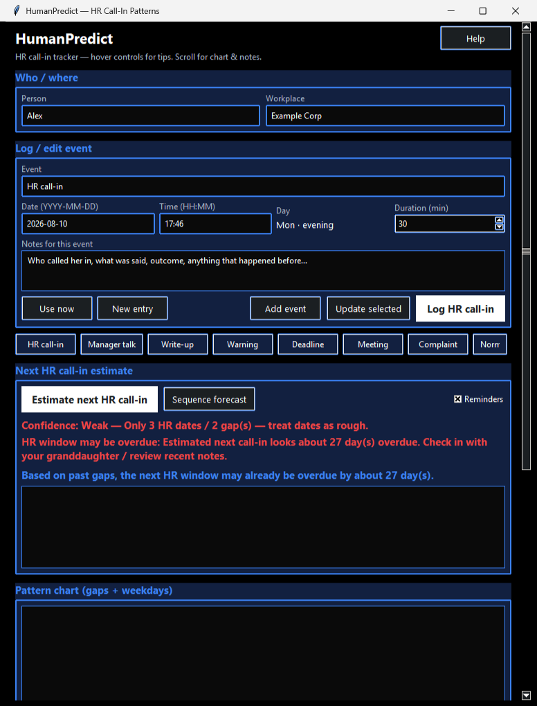
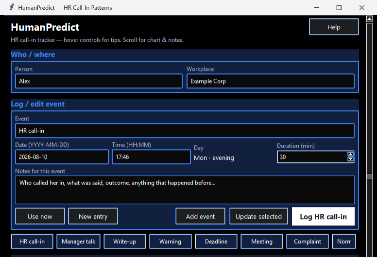
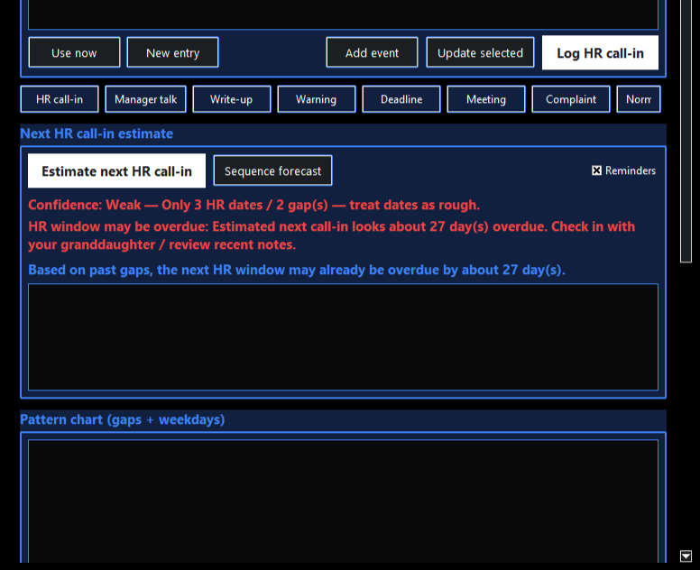

# HumanPredict — HR Call-In Pattern Tracker

A Windows desktop app for logging HR call-ins (and related workplace events), then estimating when the next call-in may fall based on past gaps, weekday/time patterns, and what often happens beforehand.

Built with Python + Tkinter. Styled after [stephenv.net](https://stephenv.net).



## Features

- **Log events** with date, time, duration, and notes  
- **Person / workplace** labels for who the log is about  
- **Before-HR checklist** when logging an HR call-in  
- **Next-date estimate** from gaps between past HR call-ins  
- **Confidence** levels: Weak / Fair / Stronger  
- **Reminders** when the estimated window is near or overdue  
- **Pattern chart** — days between call-ins + HR by weekday  
- **Edit** existing events, filter to HR-only  
- **Save PDF** (then optionally print), export text, backup JSON  
- Hover **tooltips** + Help button  





## Quick start (this PC)

```bat
python app.py
```

Or, after install:

```bat
run.bat
```

## Install on another Windows PC

### Option A — Installer (checks for Python)

1. Copy this folder to the other PC  
2. Double-click **`install.bat`**  
3. If Python is missing, install **Python 3.10+** from [python.org](https://www.python.org/downloads/windows/) (enable **Add to PATH**), then run `install.bat` again  
4. Launch from the Desktop shortcut **HumanPredict** or `run.bat`  

Details: [`SETUP.txt`](SETUP.txt)

### Option B — Standalone EXE (no Python on the other PC)

On a PC that already has Python:

```bat
build_standalone.bat
```

Copy `dist\HumanPredict.exe` to the other computer and double-click to run.

## How to use

1. Set **Person** and **Workplace**  
2. Log each **HR call-in** (date/time matter)  
3. Optionally log nearby events: Deadline, Complaint, Manager talk, etc.  
4. After **2+ HR dates**, use **Estimate next HR call-in**  
5. Click a log row to edit it or update notes  
6. Use **Save PDF** for a shareable report  

Estimates are **pattern helpers, not guarantees**.

## Project layout

| File | Purpose |
|------|---------|
| `app.py` | Tkinter UI |
| `humanPredict.py` | Markov predictor + HR gap analyzer |
| `pdf_export.py` | PDF report writer (stdlib) |
| `install.bat` / `install.ps1` | Windows installer |
| `run.bat` | Launch helper |
| `build_standalone.bat` | Build one-file EXE |
| `docs/screenshots/` | UI screenshots |

Logs are stored locally as JSON next to the app (`hr_pattern_log.json`, `hr_settings.json`) and are gitignored.

## Requirements

- Windows 10/11 recommended  
- Python 3.10+ with **tkinter** (included in the official Windows installer)  
- No third-party packages required to run  

Optional (screenshots / packaging only):

```bat
pip install -r requirements-build.txt
pip install pillow
```

## License

MIT — see [`LICENSE`](LICENSE)
